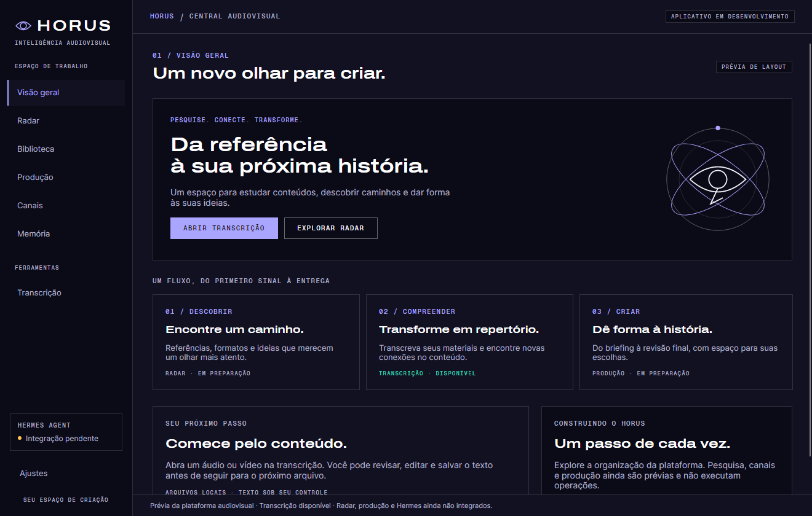

# Hórus

**Plataforma de inteligência audiovisual em desenvolvimento.**

Validação local recente: render de rascunho real pelo backend, cancelamento da árvore, persistência e seleção/reprodução de MP4 no Tauri foram exercitados. A árvore desktop foi medida com WebView2 incluído; consulte [resultados e limites](docs/validacao-local-2026-11-10.md). A instalação NSIS e a equivalência completa da transcrição continuam pendentes.

Pesquisar oportunidades, planejar vídeos originais e gerenciar a operação audiovisual. O Hórus está sendo construído para reunir pesquisa audiovisual, planejamento editorial, produção assistida por IA e acompanhamento de canais em um único espaço.

O projeto começa pela operação de um canal no YouTube. A expansão para outros canais e formatos virá depois da validação do fluxo, da qualidade e dos custos.

[Visão do produto](docs/VISION.md) · [Estado e prioridades](docs/ROADMAP.md) · [Arquitetura](docs/ARCHITECTURE.md) · [Sistema de IA](docs/AI-SYSTEM.md) · [Biblioteca de técnicas](docs/MOTION-LIBRARY.md) · [Guias e histórico](docs/planejamento/README.md)

Para agentes: leia [AGENTS.md](AGENTS.md) e use seu mapa de consulta por tarefa. Documentação de visão e planos históricos não autoriza implementar funcionalidades ou repetir autorizações antigas.

**Migração em andamento:** React/TypeScript + Tauri 2, Rust apenas para integrações nativas, Python/FastAPI e SQLite. A prova de conceito local já possui interface web, tarefas persistentes, logs e integração limitada com o CLI da fábrica. O build Tauri e o instalador Windows já foram gerados; abertura e conexão automática ao backend foram verificadas. A transcrição foi portada para a nova interface; o desktop C#/Avalonia continua disponível até a validação de equivalência. Consulte [como executar e os limites da migração](docs/migracao-local.md).

## O que já funciona

[Baixar a prévia Windows](https://github.com/yannbastos/horus/releases/tag/v0.1.0-alpha.1). O instalador inclui o backend; a prévia publicada antecede a revisão mais recente dos textos audiovisuais.

A nova interface desktop usa **React/TypeScript e Tauri 2**, com backend **FastAPI/SQLite**, operações limitadas da fábrica e biblioteca local. O desktop **C#/.NET e Avalonia** permanece como ferramenta de transcrição: importar áudio e vídeo, baixar um vídeo do YouTube, transcrever localmente com Whisper, revisar e salvar o texto. Há temas claro, escuro e do sistema e testes automatizados de interface e comportamento.

Consulte a [tabela canônica de capacidades e limites](docs/ROADMAP.md#estado-consolidado), que distingue implementado, parcialmente validado e planejado. Render real possui ensaios delimitados registrados; isso não certifica o fluxo editorial completo ou a execução por todos os modos do aplicativo.

No Avalonia, Radar, Biblioteca, Produção, Canais e Histórico operacional são prévias de layout, identificadas como em preparação, sem operações ou métricas simuladas. As telas e os dados da proposta anterior foram removidos do código. A nova base React adiciona operações limitadas da fábrica e mídia local, descritas no guia de migração.

## Prévia do desktop audiovisual



Captura do aplicativo Avalonia integrado à branch principal. O layout reorganiza a navegação e preserva a transcrição; os demais módulos aparecem como em preparação. [Capturas e limites do layout](docs/layout-desktop.md).

## Para onde o Hórus está evoluindo

O [escopo funcional](docs/VISION.md#escopo-funcional) reúne os módulos e princípios do produto. Detalhes de orquestração/memória pertencem a [AI-SYSTEM](docs/AI-SYSTEM.md); a biblioteca inteligente planejada é descrita em [MOTION-LIBRARY](docs/MOTION-LIBRARY.md). Esses objetivos não são funcionalidades prontas.

## Como os projetos se conectam

| Componente | Papel |
|---|---|
| **Hórus — este repositório** | Aplicativo e referência central do produto e do planejamento |
| [Hermes Agent](https://github.com/NousResearch/hermes-agent) | Motor de inteligência e orquestração previsto, por integração externa e sem fork inicial |
| [Fábrica de canais](https://github.com/yannbastos/fabrica-canais) | Motor independente Python/CLI e Remotion; não exige o desktop para funcionar |
| [Laboratório visual](https://github.com/yannbastos/horus-storybook) | Componentes e referências de interface em React/Storybook |

A primeira etapa é inteiramente local, sem VPS. A migração está em andamento; os componentes atuais serão preservados até validar a equivalência funcional. Autorizações anteriores foram pontuais e não concedem permissão para novas tarefas. Consulte [o planejamento de integração](docs/planejamento/README.md).

A conexão local com o Hermes CLI está descrita em [integração Hermes](docs/integracao-hermes.md). A verificação usa somente a API de diagnóstico; não envia prompts ou inicia produções.

## Transcrição

As instruções desta seção referem-se ao **desktop Avalonia**, com [Whisper.net](https://github.com/sandrohanea/whisper.net). Para o motor e o uso da transcrição React/Python, consulte a [migração](docs/migracao-local.md#transcrição). O primeiro download do modelo e a obtenção de vídeos do YouTube exigem internet.

1. Arraste arquivos (mp3, wav, m4a, mp4, mkv, ...) para a tela ou use **Selecionar arquivos**.
2. A fila é FIFO, com **até 20 arquivos incluindo o atual**. O primeiro da fila é o atual.
3. Escolha o modelo e o idioma (ou deixe a detecção automática) e clique em **Transcrever**.
4. Ao concluir, o app **para e mantém o resultado**. Revise, edite e use **Salvar .txt**. **Copiar** não libera a fila.
5. Só depois de salvar com sucesso, clique em **Próximo vídeo**. Editar o texto exige salvar novamente.

Em erro ou cancelamento, o arquivo atual e o texto parcial são preservados e **Transcrever** tenta de novo o mesmo arquivo. A fila existe apenas durante a sessão: salve o texto antes de fechar o app.

**YouTube:** cole o link de um vídeo e clique em **Baixar e adicionar à fila**. O vídeo entra no final da fila, sem substituir o resultado atual. Baixe apenas conteúdo que você tem autorização para salvar.

Dependências externas:

- **ffmpeg** no `PATH` ou na pasta do app (`winget install Gyan.FFmpeg`).
- Para o YouTube: **yt-dlp** e **Node.js 22+** (`winget install yt-dlp.yt-dlp` e `winget install OpenJS.NodeJS.LTS`). O app também procura o yt-dlp em `%LOCALAPPDATA%\Horus\tools`.

Os modelos são baixados na primeira vez para `%LOCALAPPDATA%\Horus\models`. A execução usa CPU ou runtime CUDA conforme os recursos e a configuração do ambiente.

As próximas etapas estão em [docs/ROADMAP.md](docs/ROADMAP.md).

## Tecnologias

Stack, estrutura e decisões estão em [ARCHITECTURE](docs/ARCHITECTURE.md). Os comandos de verificação por componente estão em [AGENTS.md](AGENTS.md#testes-e-verificação).

As instruções abaixo executam o desktop Avalonia. Para a nova stack e seu build, siga [migração local](docs/migracao-local.md).

## Pré-requisitos

- Windows 10 ou 11
- [SDK do .NET 10](https://dotnet.microsoft.com/download/dotnet/10.0)
- Git

## Instalação das ferramentas no Windows

Com permissão de administrador:

```powershell
winget install Microsoft.DotNet.SDK.10
winget install Git.Git
```

Sem permissão de administrador, instale o SDK na pasta do usuário com o script oficial:

```powershell
Invoke-WebRequest https://dot.net/v1/dotnet-install.ps1 -OutFile dotnet-install.ps1
.\dotnet-install.ps1 -Channel 10.0 -InstallDir "$env:USERPROFILE\.dotnet" -NoPath
```

Se já existir um `dotnet` em `C:\Program Files\dotnet`, ele tem prioridade no `PATH` e não enxerga esse SDK. Para corrigir isso, adicione esta linha ao seu perfil do PowerShell (`$PROFILE`):

```powershell
$env:PATH = "$env:USERPROFILE\.dotnet;$env:PATH"
```

Para conferir a instalação:

```powershell
dotnet --list-sdks
```

## Compilar e executar

Na raiz do repositório, usando o PowerShell:

```powershell
dotnet restore Horus.slnx
dotnet build Horus.slnx
dotnet run --project src/Horus
```

## Executar os testes

```powershell
dotnet test Horus.slnx --filter "Category!=Network"
```

Os testes não abrem janelas na tela, pois usam o modo headless do Avalonia. O teste de integração do YouTube baixa um vídeo público curto e exige internet, yt-dlp e Node.js:

```powershell
dotnet test Horus.slnx --filter "Category=Network"
```

## Suporte ao Linux

**Suporte atual:** somente Windows. O Linux ainda não é suportado nem testado, em nenhuma das implementações.

**Suporte futuro:** previsto, com atenção especial ao Arch Linux, e dependente de validação própria. O desktop Avalonia usa tecnologias multiplataforma; a nova stack também, mas já contém integrações específicas do Windows, como Job Objects e o instalador NSIS, que precisarão de equivalentes. Limites e critérios estão em [ARCHITECTURE](docs/ARCHITECTURE.md#direção-arquitetural-aprovada).

## Contribuições

O projeto ainda está na fase de fundação e o processo de contribuição não foi formalizado. Até lá, sugestões e relatos de problemas são bem-vindos.

Antes de alterar o código, leia [AGENTS.md](AGENTS.md) e [docs/ARCHITECTURE.md](docs/ARCHITECTURE.md).

## Licença

A licença open source ainda não foi definida.

## Catálogo visual

O laboratório React/Storybook fica em um repositório separado: [horus-storybook](https://github.com/yannbastos/horus-storybook). Ele reúne componentes e telas para avaliar o design antes da adaptação ao aplicativo e ao futuro site.

Na organização local, o catálogo está em `../HORUS Storybook`. Consulte o README daquele repositório para executar e verificar o catálogo. Ele é independente do aplicativo Avalonia e usa dados fictícios.
