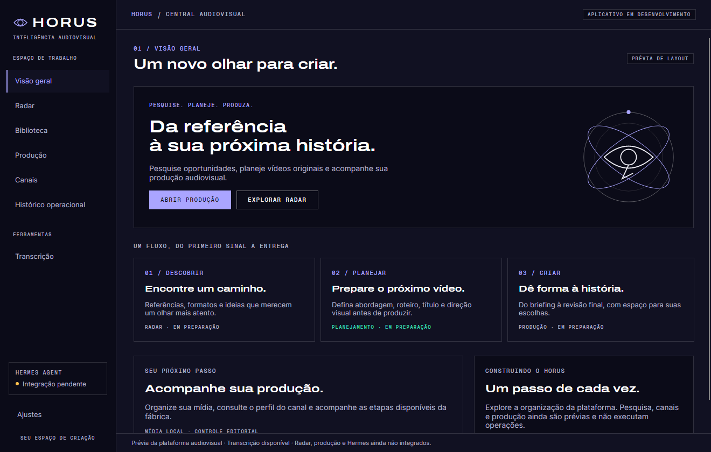
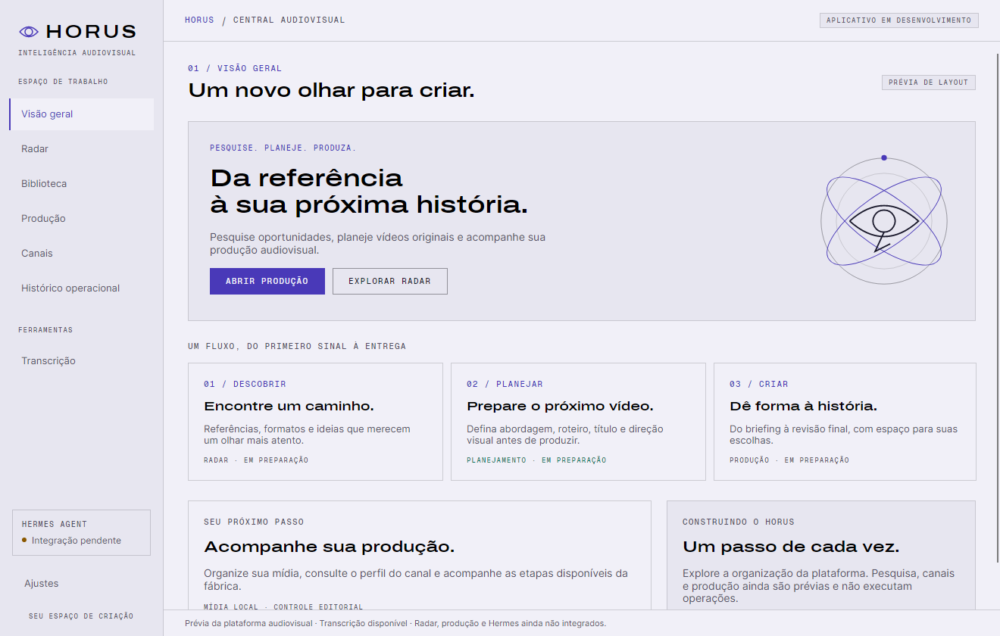

# Layout desktop audiovisual — primeira versão

Escopo autorizado: evolução visual do aplicativo Avalonia existente. Não implementa Hermes, Radar, histórico operacional, produção ou acesso à fábrica. Não adiciona dependências nem modifica os outros repositórios.

## Organização

- Visão geral como entrada, com identidade orbital e atalhos para Produção e prévia do Radar.
- Navegação lateral: Visão geral, Radar, Biblioteca, Produção, Canais e Histórico operacional; Transcrição em Ferramentas e Ajustes no rodapé lateral.
- Transcrição existente preservada, com fila e texto mantidos ao trocar de tela.
- Áreas futuras usam estados de preparação explícitos, sem cards de vídeos fictícios, estatísticas ou progresso que pareçam reais.
- Tema claro, escuro e do sistema mantidos, com índigo, linhas finas, Archivo Expanded, Inter e Geist Mono.

## Prévia escura



## Prévia clara



As imagens são capturas do aplicativo renderizado em modo headless, não mockups gerados. A altura do conteúdo pode exceder a janela; use rolagem para acessar os painéis inferiores. O tamanho mínimo deste primeiro layout é 1040 × 680.

## Verificação

Executar com o SDK .NET 10 e dependências do projeto disponíveis:

```powershell
dotnet build Horus.slnx --no-restore
dotnet test Horus.slnx --no-restore --filter 'Category!=Network'
```

Testes cobrem navegação exclusiva, atalhos, preservação de transcrição, ação principal visível em 1040/1320 pixels e temas claro/escuro, além dos testes anteriores de fila, salvamento e contraste. Não foram realizados testes de download, transcrição real ou integração Hermes neste incremento.

Na máquina de preparação, os registros de dependências dos testes precisaram ser refeitos usando somente o cache local. O cache resolveu `Avalonia.Headless.XUnit` 12.1.5 para o requisito 12.1.4, com aviso NU1603; nenhum arquivo de dependências do projeto foi alterado. Conferir a resolução no ambiente principal.

Para gerar novas capturas opcionais, definir `HORUS_LAYOUT_PREVIEW_DIR` para um diretório local, por exemplo `artifacts/layout`, antes dos testes. Não versionar logs ou toda a pasta de artefatos.
