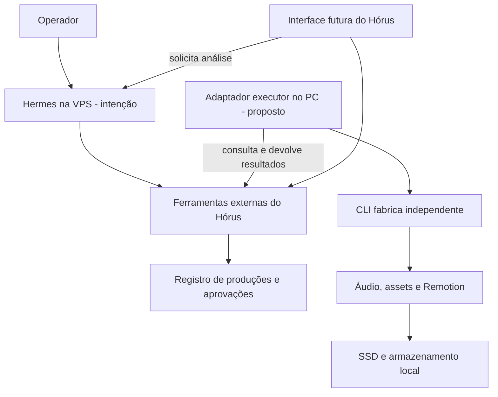

# Arquitetura híbrida — proposta VPS e PC

> **Histórico:** a proposta VPS–PC foi substituída pela decisão de execução local em [STACK-LOCAL.md](STACK-LOCAL.md). Não contratar, configurar ou exigir VPS na primeira etapa. Os cenários de integridade e recuperação abaixo podem servir de referência, mas não são o plano de implantação vigente.

Estado: contrato de responsabilidades proposto, sem infraestrutura instalada. Proposta histórica de distribuição de responsabilidades. Reavaliar após diagnóstico local do Hermes. Nenhuma contratação, conexão remota ou integração está confirmada.

## Objetivo e limites

Manter pesquisa e coordenação disponíveis quando o PC estiver desligado, e executar a fábrica no PC que tem acesso aos programas e arquivos necessários. Hermes permanece o motor de inteligência e orquestração, sem fork. Não criar outro agente ou scheduler para substituir suas capacidades.

Separar **execução do agente**, controlada pelo Hermes, de **produção audiovisual**, cujo estado e invariantes precisam de registro de domínio. Um turno encerrado não significa que um render foi concluído.

O adaptador executor é uma ponte para comandos existentes, não um segundo motor de narração/render ou um novo agente autônomo. Sua necessidade e forma dependem do suporte real do Hermes.

## Alocação proposta

| Local | Responsabilidade | O que não presumir |
|---|---|---|
| VPS, possivelmente Hostinger | Hermes, comunicação, agendamento existente, tarefas leves e registro central se aprovado | Capacidade contratada, modelo local, instalação ou disponibilidade 24/7 já existentes |
| PC Windows | CLI fábrica, conferência/alinhamento, Remotion, revisão e arquivos locais | Que esteja sempre ligado ou acessível pela VPS |
| SSD do host responsável pelo registro | Banco operacional ativo, quando criado | Banco SQLite ativo no DAS remoto ou sincronizado por cópia contínua |
| Armazenamento local/DAS mencionado no documento | Biblioteca, projetos, entregas e cópias de segurança | Acesso independente do PC, capacidade, redundância ou backup já validados |
| Serviços externos | Inferência e voz autorizadas; música/efeitos conforme licença | Que assinatura de app inclua API ou permita automação |

No primeiro teste, tudo pode continuar no PC principal sem VPS. A separação em dois hosts só entra após validar o comando de leitura e o contrato mínimo.

## Donos dos registros — proposta a validar

| Registro | Dono proposto |
|---|---|
| Conversa, turno e execução do agente | Hermes, usando interfaces públicas da versão instalada |
| Agendamento de pesquisa e relatórios | Scheduler existente do Hermes |
| Produção, versão aprovada, consumo autorizado e liberação | Camada de domínio Hórus/fábrica, com um registro oficial |
| Processo local, caminho real, recibo de execução e cancelamento | Adaptador local da fábrica |
| Configuração editorial atual | `perfil.yaml` versionado; sem segunda configuração concorrente no banco |
| Entrada utilizada por uma tentativa | Snapshot e hash do perfil/roteiro/briefing daquela execução |
| Decisões operacionais | Markdown revisado, conforme [registros operacionais](MEMORIA-ATIVA.md) |

Se a API do Hermes já oferecer alguma dessas garantias, mapear e reutilizar antes de construir a camada correspondente. Não gravar diretamente no banco interno do Hermes. IDs de produção e execução do agente são distintos e relacionados por referência.

## Conectividade mínima

Proposta preferencial para avaliação: PC inicia conexão autenticada para consultar trabalho e devolver resultados. Isso evita exigir portas de entrada no PC doméstico. Transporte exato, autenticação e disponibilidade serão decididos no diagnóstico; não há endpoint ou túnel implementado.

Não expor shell genérico, banco ou compartilhamento de mídia diretamente à internet. Aceitar operações enumeradas com parâmetros validados e caminhos confinados à raiz autorizada. Ferramentas externas, prompts e metadados de vídeos não podem autorizar ações ou modificar políticas.

Conceder identidades distintas ao operador, agente e executor. O agente propõe trabalho; somente a identidade do operador decide aprovações editoriais. A fábrica valida novamente a autorização e a revisão na fronteira da operação.

## Comportamento esperado diante de falhas

| Situação | Comportamento proposto |
|---|---|
| PC desligado | Trabalho aguarda executor; não falha por ausência de heartbeat e não gera voz à distância sem autorização |
| PC desconecta durante render | Processo pode continuar; guardar recibo local e reconciliar antes de nova execução |
| VPS reinicia | Recuperar estado persistido e reconciliar tentativas; não reenviar automaticamente operação paga incerta |
| Hermes reinicia | Consultar o estado oficial pelas ferramentas; não reconstruir aprovações a partir de conversa |
| Credencial expira | Bloquear operação, preservar entradas e mostrar ação necessária |
| Roteiro muda depois de aprovado | Invalidar aprovações/resultados dependentes e solicitar nova revisão |
| Dois executores solicitam o mesmo trabalho | Concessão exclusiva por tentativa; resultado de executor antigo não substitui o atual |
| Armazenamento local indisponível | Bloquear etapa; não cair silenciosamente para outra pasta |
| Cancelamento solicitado | Interromper no limite seguro e informar estado real; não marcar cancelado enquanto processo conhecido continua |

## Custos e autorizações

- Separar consumo de inferência, voz e infraestrutura; créditos não são moeda.
- Estimativa antes da operação, teto autorizado, tentativas e consumo informado pelo provedor são campos distintos.
- Timeout após enviar geração paga resulta em **resultado desconhecido**, não em retentativa automática.
- O custo de assinatura não comprova que chamadas programáticas estejam incluídas.
- Claude, Codex e Antigravity são recursos possíveis; disponibilidade programática, termos, autenticação e custo permanecem não investigados. Não escolher três agentes por padrão.
- Epidemic Sound aparece como intenção. Antes de integrar, verificar plano, canais cobertos, forma de obter arquivos e evidência de licença. Não implementar download automatizado presumido.

## Backup e recuperação — requisitos, não comandos executados

Backup do banco deve ser consistente com a tecnologia escolhida e acompanhado de um inventário dos artefatos. Git preserva documentos, não os arquivos de mídia ignorados. Não tratar redundância de discos como cópia de segurança.

Propor, após dimensionamento, cópias do registro, documentos, configurações sem segredos e artefatos essenciais; definir retenção, criptografia e uma cópia separada do armazenamento de trabalho. Guardar segredos por mecanismo próprio, nunca neste repositório.

Aceite de recuperação: restaurar em diretório isolado, verificar integridade, reconstituir uma produção e conferir referências de arquivos. Nunca testar restauração sobrescrevendo a operação ativa. RPO, RTO e frequência serão definidos com o usuário; não inventar capacidade ou prazo.

## Decisões pendentes antes de implementar

Versão do Hermes; localização final do registro; transporte VPS–PC; autenticação; stack mínima; mapeamento de arquivos; orçamento; armazenamento e backups. Não contratar VPS ou abrir portas para resolver antecipadamente essas escolhas.
